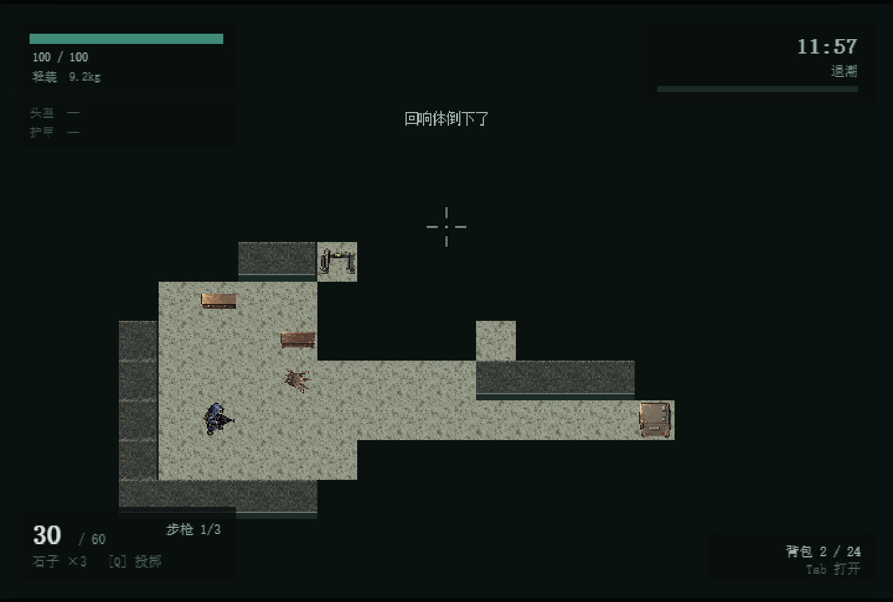
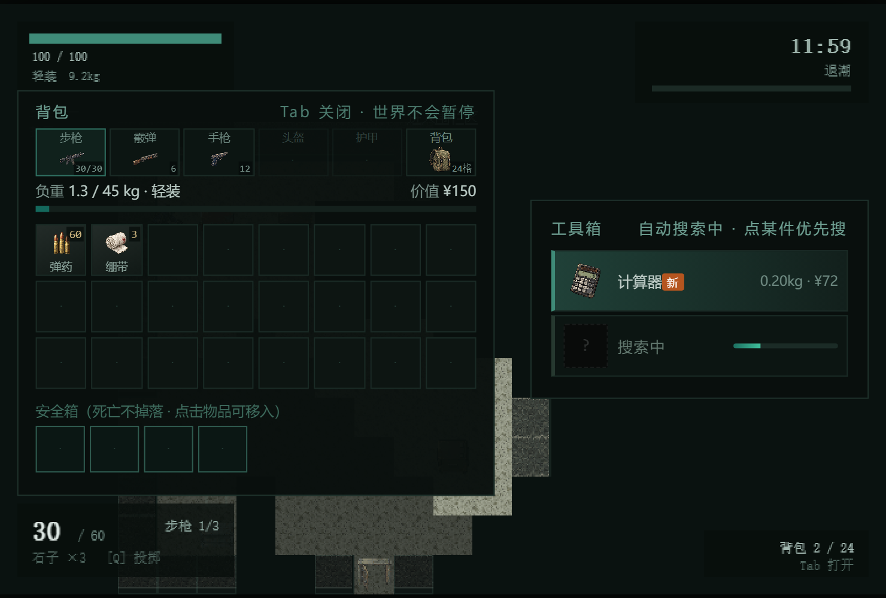
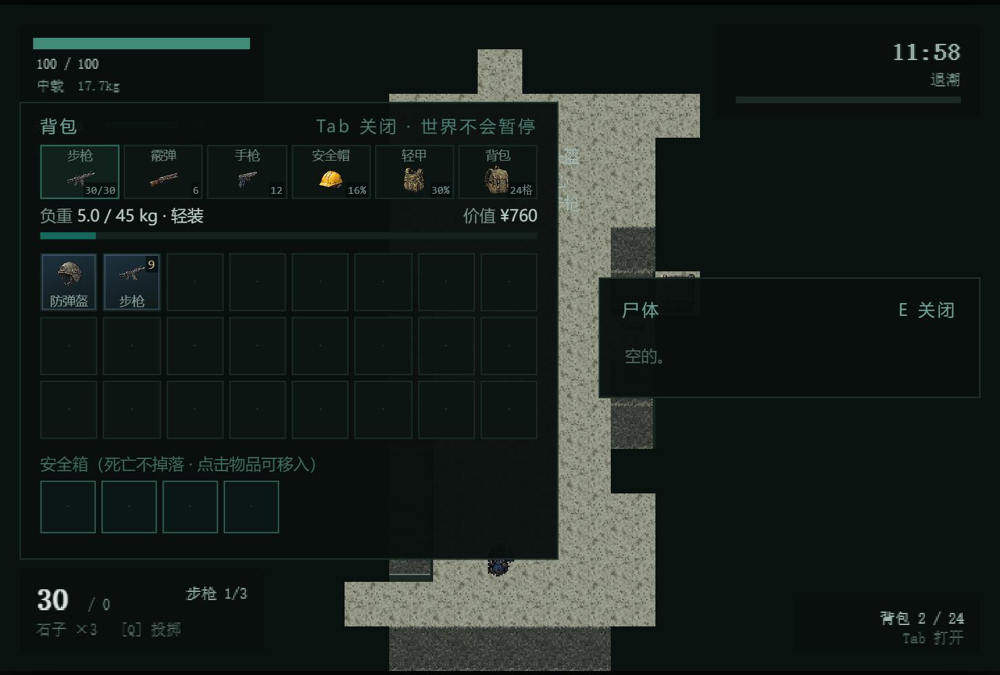
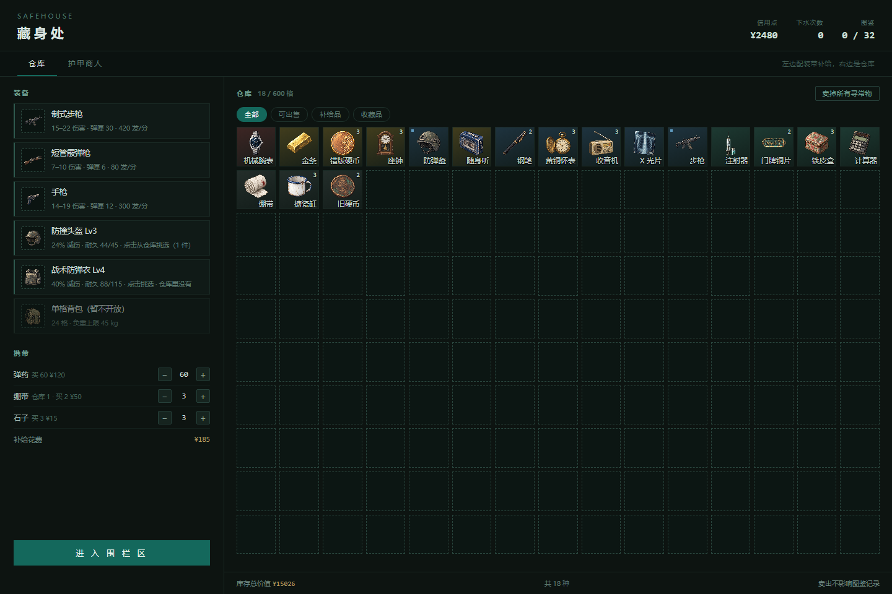

# 潮汐线 · TidalLine

一个自己写的 **2D 俯视搜打撤（extraction shooter）** 原型：单人 PvE，跑在浏览器里，
原生 Canvas 2D + Web Audio，**零依赖、零外部资源**。

> TidalLine is a 2D top-down extraction shooter prototype. Scavenge a flooded quarantine
> zone, fight the people who got here first, and get out before the tide takes the map back.



## 直接玩

双击 **`潮汐线.html`** 就行 —— 单文件，脚本和全部贴图都内联在里面，断网也能玩。
画面比例固定 3:2，窗口怎么拖都只缩放不拉伸；藏身处的仓库格子也是正方形，跟着窗口重新排行列。

从藏身处点击“进入游戏”，选择“临海路旧街区”或保留的“围栏区”，再点击“出发”。

想改代码就开 `index.html`（普通 script 标签，不用起服务器）。

## 玩法

**临海路旧街区：72×56 格，一局 12 分钟。** 西岸住宅、东岸商业区由两座桥连接，运河不可涉水。
首版采用稳定水位，南桥与低地保持通行；从两岸南侧的撤离点离开。地图和接入说明见 [MAP_LAYOUT.md](MAP_LAYOUT.md)。



**搜刮是一格一格的。** 打开容器会自动一件件往下搜，稀有度越高花的时间越长（0.45 秒到 3 秒）。
点某一件可以插队优先搜它；还没搜出来的东西不显示贴图，只显示"排队"。

**25 种容器分六档品质**（废弃 / 普通 / 充实 / 优质 / 贵重 / 秘藏），同一品质掉率完全一致，
但会偏向不同类别：办公文件柜偏情报、医疗柜与急救箱偏医疗、珠宝匣偏收藏。
开箱从即开即取到 3.6 秒，越贵越慢、越响，而且必须站定。

**159 件物品（140 件收集品 + 19 件物资），九类收集品体系，6 级稀有度。** 单格背包 24 格、安全箱 4 格（死了也不掉）、
负重 45 kg 分四档，超重会让你跑不动。带出去的东西进藏身处仓库，卖钱或者留着自己用。



**人类敌人身上穿的能扒。** 拾荒者会戴头盔、穿护甲、手里有枪。打死了，
尸体面板顶部直接摆着三格装备，左键拿走 —— 没有同类就直接穿上，有了就进背包。

**战斗**是后坐力 + 散布模型：开枪让准星张开，移动、冲刺、连续开火都会加大散布，
站定会慢慢收回来。命中分部位 —— 有同心圆的爆头判定，护甲按百分比减伤并掉耐久，
耐久跌破 50% 减伤效果打折，归零就彻底失效。



**藏身处**是局外：左边配装和补给，右边一片正方格仓库（行列按窗口实时算）。
顶部三个商人提供交易与治疗 —— **护甲商人**卖崭新的一到三级头盔护甲（更高级的货他进不到，得自己下去捡），
**军火商**卖全部四把枪、满弹匣出手。

装备和枪都是独立物品：带自己的耐久 / 余弹，可以放背包、可以换着穿、可以卖钱，
回收价按剩余耐久打折且**永远不超过买价**。三个武器位和头盔护甲一样，点一下弹出仓库列表挑一件，
换下来的自动回库。**副武器必须一直带一把手枪** —— 空手下去等于送死，所以副武器槽不给卸，
配装空了会自动补一把。

## 操作

| 键 | 作用 |
| --- | --- |
| `WASD` | 移动 |
| `Shift` / `Ctrl` | 冲刺 / 潜行 |
| 左键 | 开火（自动武器按住连发） |
| `R` | 换弹 |
| `1` `2` `3` | 切换主武器 1 / 主武器 2 / 副武器 |
| `Q` | 投掷石子（引开敌人） |
| `E` | 交互：开容器、搜尸体、开门、撤离 |
| `Tab` | 背包 |
| `F1` | 调试：显示实体格轮廓与寻路 |

## 技术

- **原生 Canvas 2D**，不用框架、不用构建工具链也能跑（`build.js` 只是把资源内联成单文件）
- **递归阴影投射视野**：先算 360° 可见，再按视锥收窄；看过的地形留在记忆层里，实体不留在上面
- **A\* 寻路**：缓冲区复用 + 二叉堆，稳态零分配；每个敌人错帧重算（0.4~0.6 秒）加直线可达优化
- **线段几何命中**：子弹按分段推进，先算最早撞墙的位置，再看这段里有没有目标
- **程序化点阵字体**：系统字体 3 倍栅格化 → 按块求覆盖率 → 二值化成点阵 → 按像素块画回去
  （详见 [DEVELOPMENT.md](DEVELOPMENT.md) 里的「文字：程序化点阵字体」）
- **合成音效**：全部用振荡器和噪声现场生成，一个音频文件都没有

想看详细设计（潮汐系统、AI 状态机、护甲数值表、验收清单）都在
[DEVELOPMENT.md](DEVELOPMENT.md) —— 那份文档比这里长得多。

## 目录

```
tide/
├── 潮汐线.html          打包好的单文件版（双击即玩）
├── index.html           开发版入口
├── js/
│   ├── config.js        所有可调参数（视野、后坐力、背包、像素字体…）
│   ├── pixfont.js       程序化点阵字体
│   ├── data.js          物品表、武器/护甲数值、地图
│   ├── core.js          地图、视野、寻路、噪声
│   ├── entities.js      玩家、敌人、子弹、尸体、背包
│   └── game.js          主循环、渲染、UI、存档、藏身处
├── assets/              贴图（item / chars / props / tiles / gear）
├── docs/screenshots/    README 用的截图
├── tools/               CDP 截图、性能探针、字体实验等小工具
├── build.js             打包成单文件
├── run-test.js          流程测试（237 项）
└── smoke-test.js        冒烟测试（31 项）
```

## 本地开发

```bash
node build.js        # 重新打包 → 潮汐线.html
node run-test.js     # 流程测试：搜刮、战斗、护甲、仓库、撤离…
node smoke-test.js   # 冒烟测试：地图、AI、物品表
```

测试在 Node 里用 mock DOM 跑完整的局内流程，不需要浏览器。
想调参数直接改 `js/config.js`，里面每一项都有注释。

## 状态

阶段一原型，玩法闭环已经跑通：**下去 → 搜 → 打 → 撤离 → 藏身处配装 → 再下去**。

还在想做的东西：

- 背包（第三个防具位）的容量与减重系统
- 更多地图与地图特产
- 图鉴 / 展览的界面
- 音效再打磨一轮

代码写得很直白，注释比代码多，改起来不难。

现有物品分为58件收集品和19件物资；收集品保留九类，其中“收藏品”更名“文物藏品”。物资分为弹药类（弹药）和医疗物品（18件，5件已开放回血），均不计收集图鉴。[逐件分类与世界观依据](design/items/CLASSIFICATION.md) · [物品索引（无图，数值速查）](design/items/ITEM_INDEX.md)。


医疗系统已开放：18件医疗品中5件可恢复HP，局内站定读条、局外立即生效；撤离保留HP，失败恢复1HP。医生出售白绿蓝药品并提供收费治疗，其余13件效果待开放。[医疗系统说明](design/items/MEDICAL.md)。


价格已按六级价值体系更新：收集品¥1,000至¥3,000,000+，医疗品与防具使用独立价格。新档¥60,000、救济线¥20,000，旧余额保留。[完整价格体系](design/items/ECONOMY.md)。
