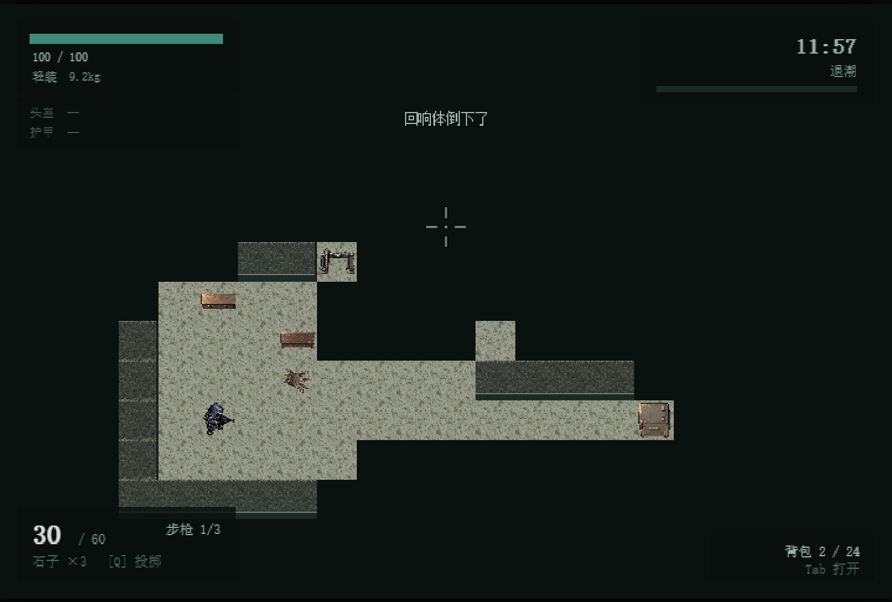
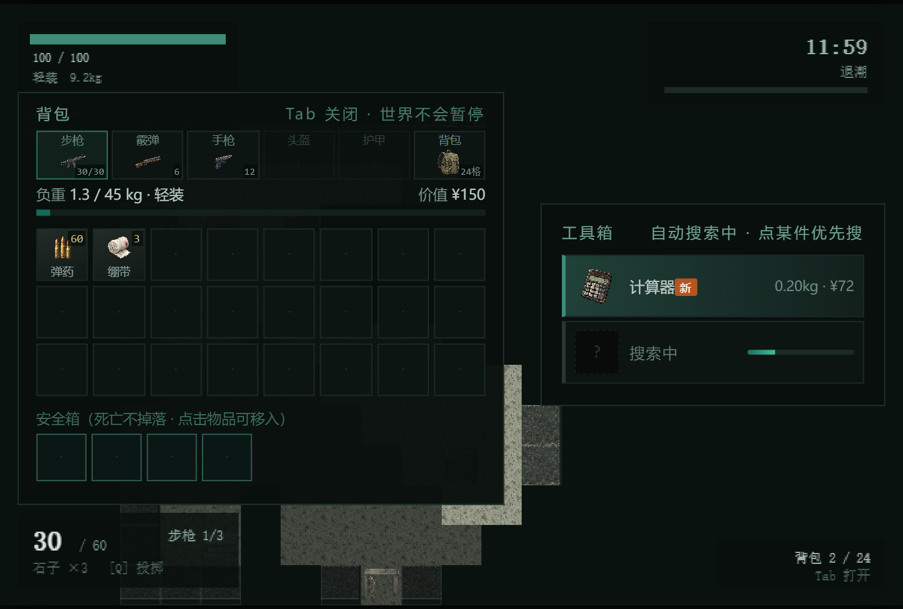
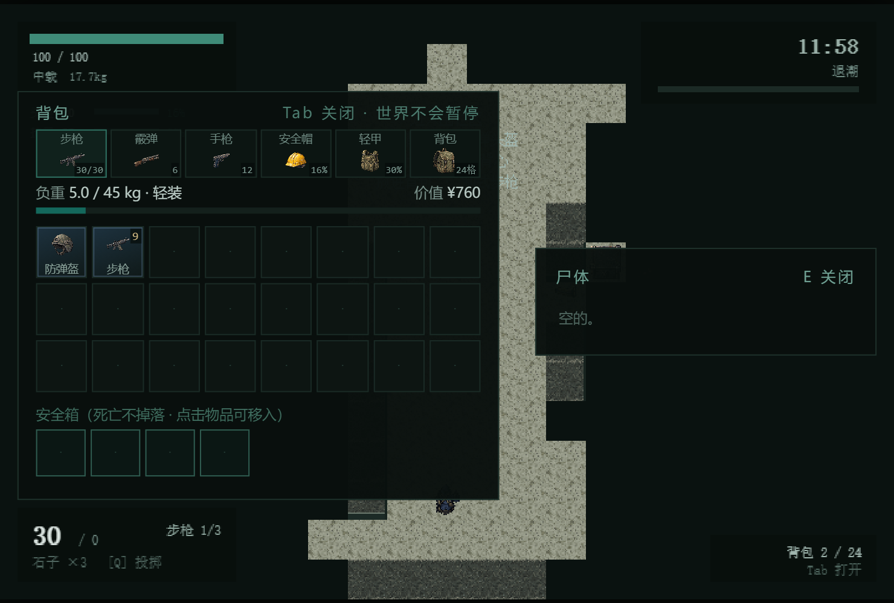
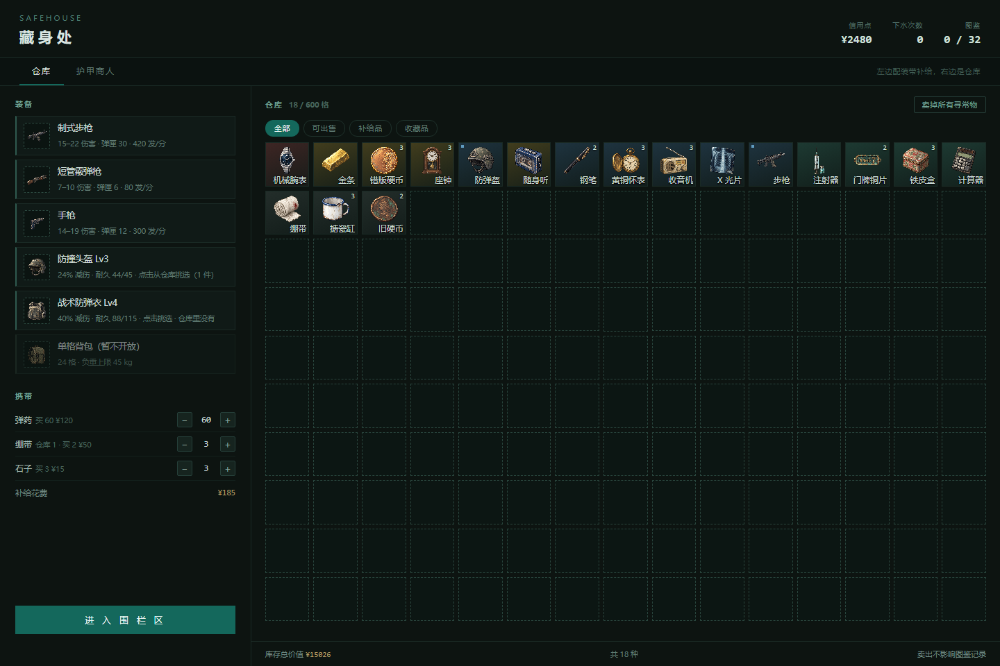

# 潮汐线 · TidalLine

一个自己写的 **2D 俯视搜打撤（extraction shooter）** 原型：单人 PvE，跑在浏览器里，
原生 Canvas 2D + Web Audio，**零依赖、零外部资源**。

> TidalLine is a 2D top-down extraction shooter prototype. Scavenge a flooded quarantine
> zone, fight the people who got here first, and get out before the tide takes the map back.



## 直接玩

双击 **`潮汐线.html`** 就行 —— 单文件，脚本和全部贴图都内联在里面，断网也能玩。
画面比例固定 3:2，窗口怎么拖都只缩放不拉伸；藏身处的仓库格子也是正方形，跟着窗口重新排行列。

从藏身处点击“进入游戏”，选择“临海路旧街区”或保留的“围栏区”，再点击“出发”。

想改代码就开 `index.html`（普通 script 标签，不用起服务器）。

## 玩法

**临海路旧街区：72×56 格，一局 12 分钟。** 西岸住宅、东岸商业区由两座桥连接，运河不可涉水。
首版采用稳定水位，南桥与低地保持通行；从两岸南侧的撤离点离开。地图和接入说明见 [MAP_LAYOUT.md](MAP_LAYOUT.md)。



**搜刮是一格一格的。** 打开容器会自动一件件往下搜，稀有度越高花的时间越长（0.45 秒到 3 秒）。
点某一件可以插队优先搜它；还没搜出来的东西不显示贴图，只显示"排队"。

**25 种容器分六档品质**（废弃 / 普通 / 充实 / 优质 / 贵重 / 秘藏），同一品质掉率完全一致，
但会偏向不同类别：办公文件柜偏情报、医疗柜与急救箱偏医疗、珠宝匣偏收藏。
开箱从即开即取到 3.6 秒，越贵越慢、越响，而且必须站定。

**159 件物品（140 件收集品 + 19 件物资），九类收集品体系，6 级稀有度。** 单格背包 24 格、安全箱 4 格（死了也不掉）、
负重 45 kg 分四档，超重会让你跑不动。带出去的东西进藏身处仓库，卖钱或者留着自己用。



**人类敌人身上穿的能扒。** 拾荒者会戴头盔、穿护甲、手里有枪。打死了，
尸体面板顶部直接摆着三格装备，左键拿走 —— 没有同类就直接穿上，有了就进背包。

**战斗**是后坐力 + 散布模型：开枪让准星张开，移动、冲刺、连续开火都会加大散布，
站定会慢慢收回来。后坐力还分两个轴——垂直把准星沿瞄准线推远，水平让它左右偏，
两个方向各自累积、各自回正；只有水平分量会真的改变弹道。命中分部位 ——
有同心圆的爆头判定，护甲按百分比减伤并掉耐久，耐久跌破 50% 减伤效果打折，归零就彻底失效。



**藏身处**是局外：左边配装和补给，右边一片正方格仓库（行列按窗口实时算）。
顶部三个商人提供交易与治疗 —— **护甲商人**卖崭新的一到三级头盔护甲（更高级的货他进不到，得自己下去捡），
**军火商**卖全部四把枪、满弹匣出手。

装备和枪都是独立物品：带自己的耐久 / 余弹，可以放背包、可以换着穿、可以卖钱，
回收价按剩余耐久打折且**永远不超过买价**。三个武器位和头盔护甲一样，点一下弹出仓库列表挑一件，
换下来的自动回库。副武器可卸下，空槽不自动补发；可以只带近战武器出发。

## 操作

| 键 | 作用 |
| --- | --- |
| `WASD` | 移动 |
| `Shift` / `Ctrl` | 冲刺 / 潜行 |
| 左键 | 开火（自动武器按住连发） |
| `R` | 短按换弹；长按250ms打开选弹轮盘，移动鼠标选择，松开后退弹并按新优先级装填（Esc取消） |
| `1` `2` `3` | 切换主武器 1 / 主武器 2 / 副武器 |
| `E` | 交互：开容器、搜尸体、开门、撤离 |
| `Tab` | 背包 |
| `F1` | 调试：显示实体格轮廓与寻路 |
| `F2`/`F3`/`F4` | 靶场（`index.html#range`）：调参面板 / 清弹孔 / 复位靶子 |

## 技术

- **原生 Canvas 2D**，不用框架、不用构建工具链也能跑（`build.js` 只是把资源内联成单文件）
- **递归阴影投射视野**：先算 360° 可见，再按视锥收窄；看过的地形留在记忆层里，实体不留在上面
- **A\* 寻路**：缓冲区复用 + 二叉堆，稳态零分配；每个敌人错帧重算（0.4~0.6 秒）加直线可达优化
- **线段几何命中**：子弹按分段推进，先算最早撞墙的位置，再看这段里有没有目标
- **程序化点阵字体**：系统字体 3 倍栅格化 → 按块求覆盖率 → 二值化成点阵 → 按像素块画回去
  （详见 [DEVELOPMENT.md](DEVELOPMENT.md) 里的「文字：程序化点阵字体」）
- **合成音效为主**：枪声、闪避、挥刀这类现场用振荡器 + 噪声合成；脚步、换弹、切枪用
  Freesound 采样补材质感（8 段，176KB，解码后走内存）。所有声音对齐同一张响度表，
  目标 RMS 写死在 `SFX.LOUD` 里，采样按实测 RMS 自动算增益，所以不会出现某个声音特别响。
  `node tools/audio-levels.js` 可以随时复测，`tools/audio-guns.html` 是试听页。

想看详细设计（潮汐系统、AI 状态机、护甲数值表、验收清单）都在
[DEVELOPMENT.md](DEVELOPMENT.md) —— 那份文档比这里长得多。

## 目录

```
tide/
├── 潮汐线.html          打包好的单文件版（双击即玩）
├── index.html           开发版入口
├── js/
│   ├── config.js        所有可调参数（视野、后坐力、背包、像素字体…）
│   ├── pixfont.js       程序化点阵字体
│   ├── data.js          物品表、武器/护甲数值、地图（生成物）
│   ├── core.js          地图、视野、寻路、噪声、掉落
│   ├── entities.js      玩家、敌人、子弹、尸体、背包
│   ├── common.js        物品索引、HTML 转义、携带容量
│   ├── medical.js       恢复治疗（容量池、启动/持续流程）
│   ├── art.js           物品图标与场景贴图加载
│   ├── ui.js            物品浮窗、右键菜单、交易框、音效
│   ├── save.js          存档、仓库与背包、图鉴、配装
│   ├── base.js          藏身处、商人、地图选择
│   ├── game.js          局内状态、输入、主循环、反馈特效
│   ├── game-update.js   每帧逻辑：更新、交互、容器、死亡与撤离
│   ├── game-render.js   绘制：地形、物件、实体、粒子、HUD
│   ├── game-panels.js   面板：搜刮、背包、装备、结算
│   ├── medhud.js        医疗 HUD（轮盘 / 快捷栏 / 进度条）
│   └── boot.js          启动：读存档、加载贴图、按 hash 进不同入口
├── assets/              贴图（item / chars / props / tiles / gear）
├── docs/screenshots/    README 用的截图
├── tools/               CDP 截图、性能探针、字体实验等小工具
├── build.js             打包成单文件
├── run-test.js          流程测试（283 项）
└── smoke-test.js        冒烟测试（31 项）
```

## 本地开发

```bash
node build.js        # 重新打包 → 潮汐线.html
node run-test.js     # 流程测试：搜刮、战斗、护甲、仓库、撤离…
node smoke-test.js   # 冒烟测试：地图、AI、物品表
```

测试在 Node 里用 mock DOM 跑完整的局内流程，不需要浏览器。
想调参数直接改 `js/config.js`，里面每一项都有注释。

## 状态

阶段一原型，玩法闭环已经跑通：**下去 → 搜 → 打 → 撤离 → 藏身处配装 → 再下去**。

还在想做的东西：

- 背包（第三个防具位）的容量与减重系统
- 更多地图与地图特产
- 图鉴 / 展览的界面
- 音效再打磨一轮（枪声目前是合成版，听感不满意就换更真实的素材）

代码写得很直白，注释比代码多，改起来不难。

现有物品分为58件收集品和19件物资；收集品保留九类，其中“收藏品”更名“文物藏品”。物资分为弹药类（弹药）和医疗物品（18件，5件已开放回血），均不计收集图鉴。[逐件分类与世界观依据](design/items/CLASSIFICATION.md) · [物品索引（无图，数值速查）](design/items/ITEM_INDEX.md)。


医疗系统已开放：18件医疗品中5件可恢复HP，局内站定读条、局外立即生效；撤离保留HP，失败恢复1HP。医生出售白绿蓝药品并提供收费治疗，其余13件效果待开放。[医疗系统说明](design/items/MEDICAL.md)。


价格已按六级价值体系更新：收集品¥1,000至¥3,000,000+，医疗品与防具使用独立价格。新档¥60,000、救济线¥20,000，旧余额保留。[完整价格体系](design/items/ECONOMY.md)。

### 弹匣与退弹

武器右键菜单支持将整匣弹药退回背包，背包空间不足时整次取消。正常换弹先使用该武器的优先弹种，不足时按背包顺序使用其他同口径等级；现有弹匣余弹保留，后续装入的子弹排在后面。轮盘选弹会先退出全部余弹，再开始装填，不跳过换弹时间。不同等级逐发记录伤害与穿透，存档和装备转移保留顺序；旧存档按原弹种补齐。HUD弹药贴图与稀有度色表示下一发，空匣时表示优先弹种。

验证：`node tools/test-reloading.js`、`node tools/test-ballistics.js`、`node tools/test-reloading-browser.js`。

### 当前观察暗层

场景不再使用未探索黑块。地形、墙体、门与固定物件始终绘制，当前未观察的格子统一覆盖暗层（`CFG.FOV.BRIGHT_FOG = 0.40`）；再次离开视野也会恢复相同暗度。敌人、尸体和遗落物仍由当前视野控制，不因地图暗显而提前出现。探索历史不决定场景亮度。专项验证：`node tools/test-observation-fog.js`。

### 近战武器首版

`4` 切换近战，`1/2/3` 切回枪械；按住左键连续挥刀。命中瞬间读取鼠标方向，前摇期间可移动转向，但不能切换、闪避或打开操作面板；普通受伤不打断。冷却跨切换与换装备保留，不消耗弹药，不损耗护甲耐久。

独立第七装备槽计入负重。首次升级/新存档赠送绑定折叠刀，仅赠送一次，可存放、卸下或丢弃，不可出售，不自动补发。军火商出售可交易的折叠刀（¥3,000）及战斗刀（¥18,000），砍刀数据与美术已就绪但无正式获取渠道。背包满、仓库满、超重均无损失败；绑定信息随转移与存档保留。

美术预览：`assets/item-art/melee/index.html`；原稿与提示词：同目录 `manifest.json`。3张48px装备图标及15张64px单帧动画条；身体约28px，脚底锚点为(32,46)，左右镜像。F1可显示挥砍扇形与命中/遮挡结果。

验证：`node tools/test-melee.js`、`node tools/test-melee-browser.js`、`node tools/test-melee-balance.js`；离线版沿用当前地图快照，通过 `node build.js --assets-only` 同步。

近战刀气使用两张透明特效（assets/effects/melee_slash_lr.png 与 melee_slash_rl.png），挥砍左右交替，按武器半径、扇角缩放和裁切，命中后160ms内淡出。预览：assets/item-art/melee-slash/index.html；验证：node tools/test-melee-slash.js。

### 死亡与行动失败装备损失

死亡触发时立即清除已装备的全部枪械（含副武器）、头盔、护甲和背包，近战槽保留，刷新或回藏身处不会补发。其他行动失败使用同一结算规则。背包中物品沿用失败丢失规则，安全箱仍保留；仓库不受影响。结算损失清单包含身上装备。成功撤离不清除装备。取消自动补发手枪，允许只带近战出发；完全没有武器时需先配装。

刀气横向长度不变，纵向厚度提高至原先2.5倍。验证：`node tools/test-death-equipment.js` 与 `node tools/test-melee-slash.js`。

弹药每格上限：12号霰弹20发、5.56×45mm为60发、9×19mm为90发，各等级相同，不同等级不合堆。旧存档超限备弹按新上限拆分，背包装不下的退回仓库，数量不丢失。

仓库与背包现在统一按口径上限分堆（12号20发、5.56为60发、9×19为90发）。入库优先填充同等级同口径的未满堆，再创建新格；旧仓库库存自动拆分且不丢数量，因迁移超出600格的旧物资仍完整保留。购买、背包入库会预检需要的新格数，放不下时不扣钱、不扣物品。

### 局外 UI v2

藏身处改为像素环境插画、设施入口、右侧据点概览和底部角色／事务／环礁湾播报三模块，右下红色备战与金色出发进入原有业务。全局导航预留任务，档案读取真实收集记录。任务、制造、伤势恢复与设施升级尚未开放，入口均有说明；不保存演示进度。

独立视觉稿：[完整局外布局](design/ui/safehouse-v2/index.html)。结构与能力划分：[设计规划](design/ui/safehouse-v2/PLAN.md)。`js/safehouse-config.js`配置导航、设施和广播；`js/safehouse.js`将共享视图接至原有Base/Save/MapSelect。广播仅总览可见时轮播，支持暂停与手动切换，离开或后台清理计时器。UI背景不进入地图素材库。

验证：`node tools/test-safehouse-ui.js`（需Playwright与Edge）；`node run-test.js`主回归300通过。离线版通过`node build.js --assets-only`同步，保留地图快照。另已确认医疗旧测试`tools/test-medical.js:42`仍期望弹药120发堆叠，当前规则为60发，更新前后均失败，未在UI任务内改写该专项。

### 商人总览与商店详情

商人入口先展示三位商人的人物卡与联络扩展规划，再进入人物／货架／详情三栏商店。分类、搜索与排序使用当前真实货架；选择商品不会扣钱，右侧购买仍经原交易确认。商品出售复用仓库，医生保留收费治疗。信任、任务、奖励与未来配件只有视觉位置与未开放说明，不创建进度。

[独立视觉稿](design/ui/merchants-v1/index.html) · [组件规划](design/ui/merchants-v1/PLAN.md)。配置在`js/merchant-config.js`，视图适配器在`js/merchant-ui.js`，样式在`assets/ui/merchant.css`。专项验证`node tools/test-merchant-ui.js`覆盖开发／离线真实交易、容量失败、重复确认、筛选与窄屏；藏身处回归导航已适配新的总览层。

### 仓库三栏界面

仓库改为分类、库存、详情三栏，容量仍为600格，分类计占格。搜索、品质筛选与排序先于分页；九类收集品独立展开，医疗物资与可用医疗品保持区分。整理只重排显示，不合堆或丢弃物品。右侧支持当前可用的入包、用药、出售、退弹与前往备战；锁定和维修明确待开放。

出售寻常收集品增加数量／金额确认，排除医疗、弹药与装备，并在确认时复核库存变化。`js/storage-ui.js`与原仓库共享节点及业务，不复制存档。[仓库视觉稿](design/ui/storage-v1/index.html) · [规划与说明](design/ui/storage-v1/DELIVERY.md)。验证：`node tools/test-storage-ui.js`，以及商人、藏身处回归；离线使用当前地图快照构建。
