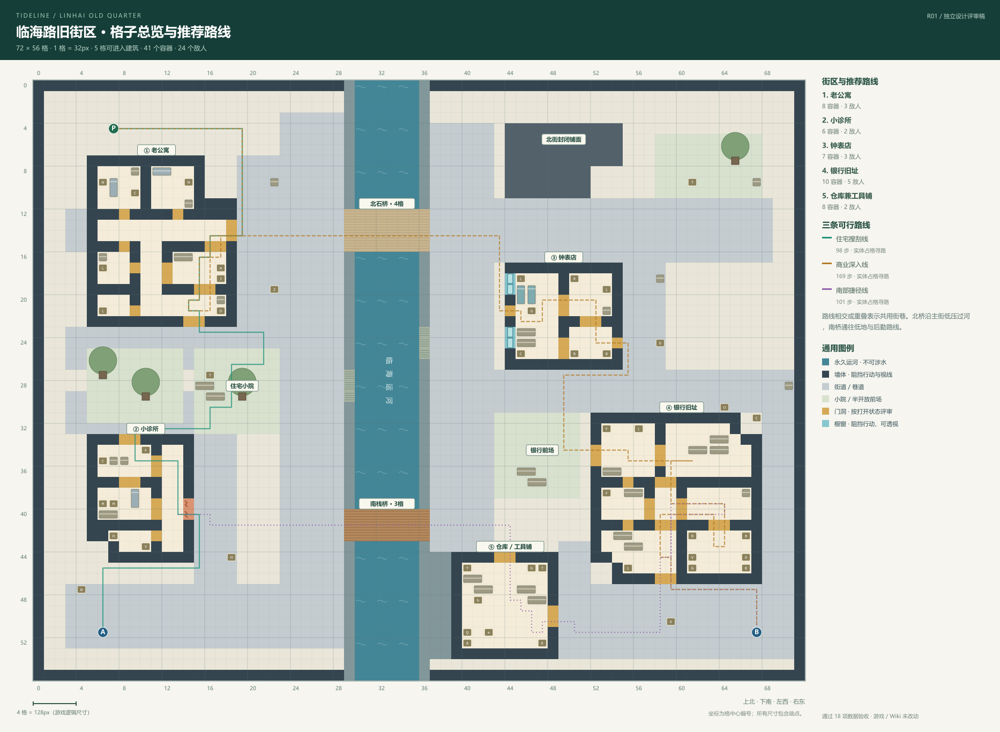

# 临海路旧街区 · R01 设计评审稿

[打开交互评审页](index.html) · [格子数据](layout.json) · [验收报告](validation.json) · [地块绘制清单](art-requirements.html)

本目录保存布局评审稿、格子数据与美术清单。72×56 地图和首批 18 张地块已经通过 tools/build-linhai-map.js 接入游戏；此目录的构建仍只更新设计资料。动态潮汐暂不启用，运行说明见 [游戏地图说明](../../../MAP_LAYOUT.md)。

## 图稿

- 格子总览与推荐路线：[PNG](figures/overview.png) / [SVG](figures/overview.svg)
- 老公寓 · 房间放大图：[PNG](figures/apartment.png) / [SVG](figures/apartment.svg)
- 小诊所 · 房间放大图：[PNG](figures/clinic.png) / [SVG](figures/clinic.svg)
- 钟表店 · 房间放大图：[PNG](figures/clockshop.png) / [SVG](figures/clockshop.svg)
- 银行旧址 · 房间放大图：[PNG](figures/bank.png) / [SVG](figures/bank.svg)
- 物资与敌人分布：[PNG](figures/encounters.png) / [SVG](figures/encounters.svg)
- 未来潮汐影响区预留：[PNG](figures/tide.png) / [SVG](figures/tide.svg)



## 尺度与空间

固定 **72×56 格**，1 格对应游戏逻辑 32px；坐标从左上角 (0,0) 开始，x 向东、y 向南。所有范围包含端点。

| 建筑 | 格子范围 | 外包围尺寸 |
| --- | --- | --- |
| 老公寓 | (5,7)–(18,22) | 14×16 |
| 小诊所 | (5,33)–(14,44) | 10×12 |
| 钟表店 | (44,17)–(54,26) | 11×10 |
| 银行旧址 | (52,31)–(67,46) | 16×16 |
| 仓库兼工具铺 | (39,44)–(48,53) | 10×10 |

运河水面 x30–35，宽 6 格，南北贯穿；两侧驳岸 x29、x36。北石桥 y12–15，宽 4 格；南栈桥 y40–42，宽 3 格。运河常态不可涉水，只有双桥可过河。仓库临河背面封闭，交通通过北侧前场和东侧三格巷道绕行。北街封闭铺面只是背景街坊，不算可进入建筑。

西岸主街 x23–28，东岸主街 x37–42，均为 6 格净宽。公寓后巷、诊所后巷、钟表店侧巷、银行北/东/南路和仓库东巷至少保留 3 格净宽；室内主要走廊保留 2 格。所有净宽在家具和容器占格之后验证；门洞允许局部为 1–2 格。住宅小院 (15,25)–(22,32)、银行前场 (43,31)–(50,38) 均为 8×8 格。

## 室内动线

### 老公寓

东北凹入后院、南侧门廊、储藏附属间。南侧门厅 → 客厅 → 侧廊；厨房通过北门与侧门接入侧廊环路。侧廊通东侧后巷门；卧室与小储藏间为支路。

房间与功能区：卧室 1、卧室 2、侧廊 · 北段、侧廊 · 两格走廊、厨房、小储藏间、客厅、门厅。

### 小诊所

西南退角、独立后勤侧廊与东侧破口。北门 → 候诊 → 诊疗；候诊和诊疗分别连接后勤侧廊。东侧破口直入侧廊，药储入口位于破口南侧，需转向进入。

房间与功能区：候诊区、诊疗室、药品储藏间、后勤侧廊。

### 钟表店

临街橱窗展示面、前店后仓与侧向连门。营业厅 → 维修间 → 后仓 → 柜台区 → 营业厅，形成内部环路；后仓侧门接东巷，橱窗不可通行但可透视。

房间与功能区：营业展示厅、柜台区、小维修间、后仓。

### 银行旧址

东北切角、前厅门廊与南侧后勤入口。前厅 → 柜台 / 办公室 → 柜台后通道 → 安保室 → 金库。南门接后勤环廊；办公室、后通道、后勤三者成环，金库只经安保门进入。

房间与功能区：前厅、柜台营业区、办公室、柜台后通道、安保室、后勤环廊、金库 / 保险区。

### 仓库兼工具铺

北侧装卸入口接南桥低地，东侧侧门接三格绕行巷。中央两格通道和横向两格通道穿过货架布置，形成可绕行的装卸空间。普通工具箱靠入口，防水补给箱位于内部。

实体家具、箱柜、树木均占一格；河面与驳岸不可通行。橱窗阻挡行动但可透视，现有破口无需新交互。门洞按打开状态检查连通性；不引入钥匙、门禁、破墙操作或机关。

## 物资与守备

| 分区 | 容器 | 敌人 |
| --- | ---: | ---: |
| 老公寓 | 7 | 3 |
| 小诊所 | 5 | 2 |
| 钟表店 | 6 | 3 |
| 银行旧址 | 10 | 5 |
| 仓库兼工具铺 | 5 | 2 |
| 街巷 / 小院 / 河岸 | 8 | 9 |

全图 **41 个容器、24 个敌人、40 处实体家具/摆设**。敌人为 12 名拾荒者、7 只回响体、5 名银行守卫。容器类型为 C 抽屉 9、L 储物柜 10、B 保险箱 8、T 工具箱 4、M 医疗柜 5、R 电子设备柜 3、K 防水补给箱 2。

物资偏好已接入通用容器（专用容器优先保留自身类别），掉落数量不增加：住宅偏生活，诊所偏医疗，钟表店偏古玩/奢侈品，银行偏保险物资与收藏品，仓库偏工业/电子。所有固定点位在评审页和 JSON 中有编号及坐标。

银行 5 名守卫分布在前厅、柜台、办公室及安保区。金库内不堆怪；前厅与金库之间始终有办公和安保过渡。北桥与桥头不设固定堵桥点，南桥也不设固定关卡。敌人之间至少相距 3 格，距出生点至少 12 格，两处撤离点 6 格范围内没有固定敌人。巡逻半径已接入 AI；调查与追击规则沿用原实现。

## 起点与三条路线

出生 P：(7,4)。西岸撤离 A：(6,51)；东岸撤离 B：(67,51)。

- **住宅搜刮线**：公寓 → 小院/后巷 → 诊所 → 西岸撤离；图中为实体占格 BFS 寻路，共 98 个格间步长（含搜刮折返）。
- **商业深入线**：公寓 → 北桥 → 钟表店 → 银行 → 东岸撤离；图中为实体占格 BFS 寻路，共 167 个格间步长（含搜刮折返）。
- **南部捷径线**：诊所后巷 → 南桥 → 仓库/银行后勤 → 东岸撤离；图中为实体占格 BFS 寻路，共 101 个格间步长（含搜刮折返）。

## 潮汐预留

- 南桥东端低地：(37,39)–(48,43)。
- 仓库东巷低地：(49,43)–(51,49)。
- 西岸阶梯：(29,27)–(29,29)。
- 东岸阶梯：(36,23)–(36,25)。

本轮没有水位、减速、低地封路、南桥失效或河岸上水逻辑。低地在设计稿中仍可通行；蓝色运河则始终不可涉水。验收额外模拟这些预留区域与南桥封闭，证明未来局部潮汐不会切断北桥和两处撤离路线。

## 数据与复现

- source.cjs：唯一手工设计源，含地形、建筑轮廓、房间、门、家具、点位、净宽与路线节点。
- layout.json：由设计源生成，包含图例、格子行、建筑和房间、门洞、橱窗、家具、容器、敌人、起点、撤离点、桥、潮汐预留与实际路线。
- validate.cjs：验收逻辑，可独立读取已交付 JSON；不依赖游戏运行环境。
- render.cjs / build.cjs：同源 SVG/PNG 与评审页生成。PNG 需要 sharp。

在项目根目录运行：

```powershell
node design/maps/linhai-old-quarter/validate.cjs
node design/maps/linhai-old-quarter/build.cjs
```

若 sharp 未在默认模块路径中，可使用本机已配置的 Node 依赖目录设置 NODE_PATH。源数据由 tools/build-linhai-map.js 编译为游戏快照；运行 node build.js 会校验并同步地图，源稿仍保持评审格式。

## 验收结果

- [x] 72×56 方格、完整图例与不可越界边缘
- [x] 实体家具与 41 个箱柜无重叠、无地形冲突
- [x] 全部空地、室内、门洞、阶梯与两处撤离点连通
- [x] 每个箱柜都有可达、可交互的操作面
- [x] 主街 6 格、支巷至少 3 格、主要室内走廊 2 格净宽
- [x] 两座桥为仅有的跨岸路线，任一桥均可独立连接两岸
- [x] 五栋建筑均有两处独立室外入口，诊所有两格破口
- [x] 公寓、诊所与钟表店有实际室内绕行，药储不直连破口
- [x] 银行必须通过安保过渡门和金库门，金库不连接室外
- [x] 分区物资 / 布防配额、敌人间距和出生 / 撤离缓冲
- [x] 室内物资与敌人确实位于所属建筑，室外点不混入室内
- [x] 潮汐只做预留：低地仍可通行，稳定路线不受模拟封路影响
- [x] 三条推荐路线均按实体占格寻路生成
