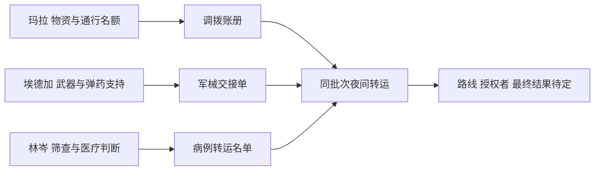

# 商人支线关系与关键节点 v1.0

共同事件暂称“夜间转运”，为用户本次提供的新剧情方向，未写入已确认的世界史。证据只建立弱关联，不预设三人共谋灾害或共同知道最终真相。

|阶段|证据或节点|玩家可知|保留的疑问|
|---|---|---|---|
|初识|三条职业委托|各自能供货且讲究交付|为何如此重视部分旧记录|
|熟客|仓单／样枪日志／隔离记录|记录存在修改或信息缺口|谁作出修改，动机是什么|
|合作者|运输名单、试射说明、维持读数|三人各自承担过职责，也有省略|省略是否足以改变对其行为的评价|
|关键分支|完整原件与独立核对路径|玩家可选择合作或提出异议|真相的不同部分如何相互印证|
|核心关系|三份高信任补充材料|各人的隐瞒及价值判断更明确|不强行给出唯一统一叙述|
|后续扩展|共同转运行动的更多记录|可从任一独立支线进入关联线|完整路线、授权者、抵达结果另行设计|

共享剧情的发现不要求三位商人同时满级，也不成为任一商店毕业的额外门槛。角色平日仍有采购、维护、治疗和普通交易，不让同一次往事占据全部对白。
